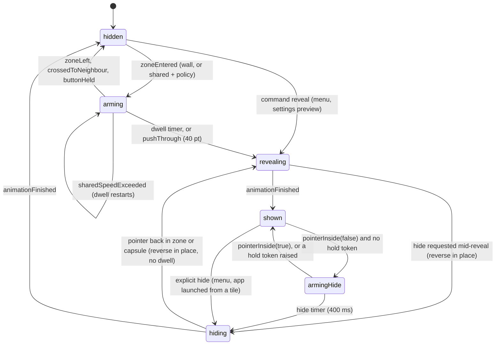

# dedock architecture

This is dedock's own architecture document for the code in this repository. It covers the static structure (stack, modules, dependency rules, folder layout), the Edge Dock subsystem that ships first (v0), how later pillars plug in, permissions and testing.

It is adapted from the reference pack. Where this document and the pack disagree, this document wins for this repo, and §12 lists every deliberate difference.

**Citations.** Paths in backticks are relative to the `dedock/` parent folder, for example `<pack>/dedock-plan/system-design.md`. They are not relative to this file, so they stay valid after a merge to `develop`. Once a file's full path has appeared, later mentions may use its bare name (`system-design.md`, `ux-patterns.md`, `animation-spec.md`, `side-dock-modes.md`, `features.md`, `design-system.md`); those live in `<pack>/dedock-plan/` or `<pack>/dedock-inputs/`.

**Milestones.** "v0" in this document is **M1 Edge Dock reveal** in `docs/plan.md` §4.1; later milestones use the plan's M2…M18 names.

**Labels.** *(design choice)* marks a value dedock picks and can tune. *(inferred)* marks a platform claim that has not been checked against a primary source; each one has a check in `docs/evaluation.md`. *(verified)* means it was checked on this Mac (macOS 27.0.1, Swift 6.4, Command Line Tools only).

**Clean-room rule.** DockDoor is GPL-3.0. dedock reproduces its features and behaviour, never its code. The same rule applies to Docky, tungsten-edge and the other GPL projects in `<pack>/research/side-dock-prior-art.md`. The pack is read for techniques and numbers only. The visual design (materials, shapes, colours, icons, type) is dedock's own and is deliberately different from both DockDoor and CoolDock. Reference screenshots are for comparison only.

**Notchy is out of scope.** Nothing from `<pack>/notchy/` or `<pack>/research/notchy-*` is read, cited or used (`docs/plan.md` D-8).

---

## 1. Product shape and stack

dedock is two products in one menu-bar agent app:

- **Edge Dock** (Pillar B, CoolDock-class): a second dock of apps, folders and, later, widget tiles. It slides out when the pointer touches a screen edge. Left and right are the defaults; bottom and top (below the menu bar) are optional.
- **Window previews** (Pillar A, DockDoor-class): hover an app in the native Dock or the Edge Dock to see its windows, plus a window switcher, Cmd+Tab previews and window actions. These come after v0.

| Property | dedock | Why |
|---|---|---|
| App type | Agent app: `LSUIElement = YES`, activation policy `.accessory`, one status item. It switches to `.regular` only while the Settings window is open. | Same shape as both references (`<pack>/dedock-plan/architecture.md` §1) |
| Language | Swift 6 language mode, strict concurrency. Upcoming features `NonisolatedNonsendingByDefault`, `InferIsolatedConformances`, `ExistentialAny`. | Compiles on Swift 6.4 *(verified)* |
| UI | SwiftUI views inside AppKit `NSPanel`/`NSWindow` via `NSHostingView`. AppKit owns windows, levels, the status item, mouse handling and drag. | SwiftUI scenes cannot express non-activating panels or window levels |
| Entry point | AppKit `main.swift` (`NSApplication.shared`, an `AppDelegate`, `run()`). No SwiftUI `App`, no `Settings` scene. | v0 has no scenes. An AppKit agent app cannot open a SwiftUI `Settings` scene from an `NSMenu` without the private `showSettingsWindow:` selector, so Settings is an `NSWindow` dedock owns (§8). |
| Min OS | macOS 14.0 | Reference floor (`<pack>/dedock-plan/architecture.md` §1) |
| Build system | **SwiftPM only.** One root `Package.swift`, library targets for the modules, one `Dedock` executable target. `Scripts/make-app.sh` wraps the binary into `build/Dedock.app`. | Xcode is not installed, only Command Line Tools. `xcodebuild`, XCTest and XCUITest are unavailable; `swift build` and `swift test` with swift-testing work *(verified)*. An `.xcodeproj` can be added later on top of the same package without moving code. |
| Tests | swift-testing (`import Testing`), run by `swift test` | XCTest ships only with Xcode; swift-testing ships with the Command Line Tools *(verified: parameterised tests run)* |
| Sandbox | None. Hardened Runtime later with Developer ID. | Pillar A needs private APIs and event taps (`<pack>/dedock-plan/architecture.md` §1) |
| Signing (v0) | Ad-hoc (`codesign --sign -`) | No identity exists on this Mac. v0 needs no TCC grant, so ad-hoc is enough (§10). |
| Bundle id (v0) | `app.dedock.Dedock.debug` | Debug grants never collide with a future release id `app.dedock.Dedock` |
| Dependencies | **None** in v0 | Sparkle and the other references' packages arrive with distribution and Pillar A, pinned to tags |
| Network | None in v0 | No feature in v0 needs it |

**Why SwiftPM-first is fine for this app.** Everything an Xcode project would add (asset catalogues, `.xcstrings`, entitlements, the sdef) is either not needed in v0 or can be produced by the script. Logic lives in library targets, so `swift test` exercises it without an app host. The cost is that the app is assembled by a script instead of a build phase (§5), and UI tests are manual until Xcode is available (§11).

---

## 2. Module map

All modules are targets of the root package. v0 builds the modules in **bold**; the others are named so that later work has a fixed place to go.

| Layer | Module | Owns in v0 | Imports | Isolation |
|---|---|---|---|---|
| L0 | **DedockCore** | `ScreenEdge`, `DisplayIdentity`, `DisplaySnapshot`, `DisplayLayout`, geometry helpers (rect/interval maths, edge-relative axes), `PointerSample`, IDs (`DockID`, `TileID`, `ProfileID`), cross-feature protocols (`EdgeDockControlling` in v0; `NativeDockGeometryProviding` and `PreviewPresenting` are added when their second implementation or first consumer lands, M2/M3), `HoldOpenToken` | Foundation, CoreGraphics types only | nonisolated, all `Sendable` |
| L1 | **Diagnostics** | `os.Logger` categories, `OSSignposter` names, the edge trace | DedockCore, os | nonisolated |
| L1 | **DesignSystem** | dedock's own tokens (size, spacing, radius, colour, materials), motion tokens from `<pack>/dedock-inputs/animation-spec.md` §2.1, the `FloatingPanel` base class, shared SwiftUI components (tile chrome, running indicator, label pill), Reduce Motion / Reduce Transparency switches | DedockCore, AppKit, SwiftUI | `@MainActor` for views and panels |
| L1 | **DisplayTopology** | Reads `NSScreen` and CoreGraphics display info into `DisplayLayout` values, observes screen changes and wake | DedockCore, Diagnostics, AppKit | `@MainActor` |
| L2 | **EventTapKit** | v0: `PointerHub` only (NSEvent monitors, throttling, menu-tracking fallback). Later: `EventTapHost` (CGEvent taps) and hotkeys | DedockCore, Diagnostics, AppKit | `@MainActor` |
| L2 | **SettingsStore** | The dedock document (`layout.json`): schema, migrations, typed model, observation, atomic save | DedockCore, Diagnostics, Foundation | `actor LayoutFile` for I/O, `@MainActor @Observable SettingsModel` for binding |
| L3 | **EdgeDock** | Trigger geometry, reveal state machine, reveal controller, `EdgeDockPanel`, layout engine, tiles, running apps, native-Dock environment, fullscreen probe, the per-dock coordinator | DedockCore, Diagnostics, DesignSystem, DisplayTopology, EventTapKit, SettingsStore | pure logic nonisolated; everything else `@MainActor` |
| L4 | **SettingsUI** | Settings window shell and the Edge Dock pane (scenario cards, timing and placement controls, tile list) | DedockCore, DesignSystem, SettingsStore, DisplayTopology | `@MainActor` |
| App | **Dedock** (executable) | Composition root, `AppDelegate`, status item and menu, lifecycle (launch, wake, quit) | everything above | `@MainActor` |
| Test | **DedockTestSupport** | `TestClock`, fake display layouts, fake pointer source, fake animator and gate | DedockCore, EventTapKit, EdgeDock | used only by test targets |
| later | PrivateBridges, Permissions, WindowKit, DockObserver, PreviewUI, Switcher, DedockWidgets, Automation, Updates | see §9 and `<pack>/dedock-plan/architecture.md` §4 | — | — |

In short: `DedockCore` ← {`Diagnostics`, `DesignSystem`, `DisplayTopology`} ← {`EventTapKit`, `SettingsStore`} ← `EdgeDock` / `SettingsUI` ← `Dedock`. `PointerHub` stays in `EventTapKit`, as in the reference module list (`<pack>/dedock-plan/architecture.md` §12), so the tap host has a home when Pillar A adds it. `DisplayTopology` is its own module because preview and switcher placement (Pillar A) need the same display model.

---

## 3. Dependency rules

| Rule | Statement | Enforcement |
|---|---|---|
| D1 Layering | A module imports only modules in a lower layer. The app target is the only place that sees every module. | `dependencies:` lists in `Package.swift`. A missing edge is a compile error. |
| D2 Features never import each other | `EdgeDock`, and later `PreviewUI`, `Switcher` and `DedockWidgets`, do not import one another. The single planned exception is `EdgeDock → DedockWidgets` (the dock renders widget tiles), as in `<pack>/dedock-plan/architecture.md` §5 D2. | `Package.swift` |
| D3 Cross-feature calls go through Core protocols | Example: the Edge Dock asks for a preview through `PreviewPresenting` (declared in `DedockCore`); `PreviewUI` implements it; the composition root injects it. `SettingsUI` changes the dock only by writing `SettingsModel`; it never calls `EdgeDock`. | Compile-time: the import is not available |
| D4 No AppKit or SwiftUI in Core | `DedockCore` imports Foundation and CoreGraphics only | `Scripts/check-deps.sh` (`docs/plan.md` T1) |
| D5 Pure logic stays pure | The pure files in `Sources/EdgeDock/Logic/` (`EdgeGeometry`, `TriggerEvaluator`, `RevealStateMachine`, `LayoutEngine`) import only Foundation, CoreGraphics and `DedockCore`. They hold no clock, no timer and no reference types. Nothing impure lives in `Logic/`; the controller, coordinator and manager live in `Controller/`. | the Linux build of `Logic/` (no AppKit) plus `Scripts/check-deps.sh` by folder, run by CI `guards` on every push |
| D6 Main actor for UI, actors for I/O | Anything touching `NSWindow`, `NSView`, `NSEvent` or SwiftUI state is `@MainActor`. File I/O runs on `actor LayoutFile`. No locks in feature code. | Swift 6 strict concurrency |
| D7 Settings only through SettingsStore | No module reads or writes `layout.json` or `UserDefaults` directly | review + grep |
| D8 No private API and no network in v0 | No `dlsym`, no SkyLight or CoreDock symbols, no `URLSession`. Private symbols arrive with Pillar A, only inside `PrivateBridges`, resolved with `dlsym`, each optional (`<pack>/dedock-plan/architecture.md` §8). | grep |

---

## 4. Repository layout

The repository root is the `Dedock app` folder (note the space; every script quotes paths). Each feature is built in a worktree at `Dedock app/.worktrees/<feature>` on branch `feature/<feature>` off `develop`, merged back by PR. Every worktree has the same tree:

```text
Dedock app/                              repo root (and the root of every worktree)
├── Package.swift                        all targets; swift-tools-version 6.2
├── README.md
├── Support/
│   └── Info.plist                       template; make-app.sh fills bundle id and version
├── Sources/
│   ├── DedockCore/
│   │   ├── Geometry/                    ScreenEdge, edge-relative axes, rect and interval maths
│   │   ├── Displays/                    DisplayIdentity, DisplaySnapshot, DisplayLayout
│   │   ├── Pointer/                     PointerSample, ModifierSet
│   │   ├── IDs/                         DockID, TileID, ProfileID
│   │   └── Protocols/                   EdgeDockControlling (NativeDockGeometryProviding, PreviewPresenting from M2/M3)
│   ├── Diagnostics/                     Log.swift, Signposts.swift, EdgeTrace.swift
│   ├── DesignSystem/
│   │   ├── Tokens/                      sizes, spacing, radii, colours, materials (dedock's own)
│   │   ├── Motion/                      dd.motion.* tokens (docs/design.md §3), Reduce Motion mapping
│   │   ├── Panel/                       FloatingPanel base class
│   │   └── Components/                  tile chrome, running indicator, label pill
│   ├── DisplayTopology/                 DisplayTopology.swift, ScreenReader.swift, DisplayIdentity+CG.swift
│   ├── EventTapKit/
│   │   └── PointerHub/                  PointerHub.swift, NSEventPointerSource.swift, Throttle.swift
│   ├── SettingsStore/
│   │   ├── Model/                       DedockDocument, DockConfig, Profile, TileItem, AppPreferences, JSONValue (lossless round-trip of unknown keys; moves to DedockCore if a second module needs it)
│   │   ├── Schema/                      schemaVersion, Migration(n → n+1)
│   │   └── Store/                       LayoutFile (actor), SettingsModel (@Observable), DataDirectory
│   ├── EdgeDock/
│   │   ├── Logic/                       pure: EdgeGeometry (zones), TriggerEvaluator, RevealStateMachine, LayoutEngine (also built on Linux)
│   │   ├── Controller/                  EdgeRevealController, EdgeDockCoordinator, EdgeDockManager, DockConfigMapping
│   │   ├── E2E/                         GeometryWriter (debug bundle only)
│   │   ├── Panel/                       EdgeDockPanel, DockContentView, SlideAnimator, ClickThroughGate
│   │   ├── Tiles/                       TileViews, RunningAppsMonitor, IconCache, TileActions
│   │   ├── Drag/                        ReorderSession
│   │   ├── NativeDock/                  DockPreferencesReader (com.apple.dock), HotCornerReader
│   │   └── Displays/                    FullscreenProbe, SpaceMembershipRepair
│   ├── SettingsUI/
│   │   ├── Window/                      SettingsWindowController, sidebar shell
│   │   └── EdgeDockPane/                ScenarioCards, TimingSection, PlacementSection, TileListEditor
│   └── Dedock/                          executable target
│       ├── main.swift
│       ├── AppDelegate.swift
│       ├── CompositionRoot.swift
│       └── StatusItem/                  StatusItemController, StatusMenuBuilder
├── Tests/
│   ├── DedockTestSupport/               TestClock, FakeDisplays, FakePointerSource, FakeAnimator, FakeGate
│   ├── DedockCoreTests/                 interval maths, edge axes, DisplaySnapshot derivation (menu bar, notch)
│   ├── EventTapKitTests/                throttle, trailing sample, menu-tracking fallback
│   ├── SettingsStoreTests/              round-trip, unknown-key preservation, migrations, corrupt-file recovery
│   ├── EdgeDockTests/                   EdgeGeometry, TriggerEvaluator, RevealStateMachine, LayoutEngine, NativeDock tests; EdgeRevealController tests with DedockTestSupport fakes (follow-up)
│   └── E2E/<feature>.md                 E2E scripts (docs/evaluation.md §7)
├── Scripts/
│   ├── make-app.sh                      build → build/Dedock.app → ad-hoc sign
│   ├── run.sh                           make-app.sh, quit a running copy, run in the foreground
│   ├── check-deps.sh                 rules D4, D5, D8 (docs/plan.md T1; run by CI `guards`)
│   ├── measure-idle.sh                  idle CPU / RSS sampler (docs/evaluation.md §6)
│   └── measure-pixels.swift             pixel and edge measurement (docs/evaluation.md §8, §9)
├── Tools/
│   └── (E2E driver lives in Scripts/e2e/pointer.swift, owned by the E2E lane)
├── docs/
│   ├── architecture.md                  this file
│   ├── plan.md  design.md  evaluation.md  organization.md  status.md
│   └── features/ design/ compare/ evidence/   per-feature docs (docs/organization.md §3)
├── build/                               gitignored: Dedock.app
└── .worktrees/                          gitignored: feature worktrees (repo-root checkout only)
```

`Info.plist` lives in `Support/`, outside `Sources/`, so SwiftPM never treats it as a resource. v0 declares **no** `resources:` on any target: the status item uses an SF Symbol, so there is no `Dedock_Dedock.bundle` to copy and `Bundle.module` is never used. When resources arrive, `make-app.sh` must copy the generated `*.bundle` into `Contents/Resources`.

### 4.1 Package.swift (sketch)

The settings below compile and test on Swift 6.4 *(verified with a scratch package)*.

```swift
// swift-tools-version: 6.2
import PackageDescription

let strict: [SwiftSetting] = [
    .enableUpcomingFeature("NonisolatedNonsendingByDefault"),
    .enableUpcomingFeature("InferIsolatedConformances"),
    .enableUpcomingFeature("ExistentialAny"),
]

let package = Package(
    name: "Dedock",
    platforms: [.macOS(.v14)],
    products: [.executable(name: "Dedock", targets: ["Dedock"])],
    targets: [
        .target(name: "DedockCore", swiftSettings: strict),
        .target(name: "Diagnostics", dependencies: ["DedockCore"], swiftSettings: strict),
        .target(name: "DesignSystem", dependencies: ["DedockCore"], swiftSettings: strict),
        .target(name: "DisplayTopology", dependencies: ["DedockCore", "Diagnostics"], swiftSettings: strict),
        .target(name: "EventTapKit", dependencies: ["DedockCore", "Diagnostics"], swiftSettings: strict),
        .target(name: "SettingsStore", dependencies: ["DedockCore", "Diagnostics"], swiftSettings: strict),
        .target(name: "EdgeDock", dependencies: ["DedockCore", "Diagnostics", "DesignSystem",
                                                 "DisplayTopology", "EventTapKit", "SettingsStore"], swiftSettings: strict),
        .target(name: "SettingsUI", dependencies: ["DedockCore", "DesignSystem", "DisplayTopology",
                                                   "SettingsStore"], swiftSettings: strict),
        .executableTarget(name: "Dedock", dependencies: ["DedockCore", "Diagnostics", "DesignSystem", "DisplayTopology",
                                                         "EventTapKit", "SettingsStore", "EdgeDock", "SettingsUI"],
                          swiftSettings: strict),
        .target(name: "DedockTestSupport", dependencies: ["DedockCore", "EventTapKit", "EdgeDock"],
                path: "Tests/DedockTestSupport", swiftSettings: strict),
    ] + ["DedockCore", "EventTapKit", "SettingsStore", "EdgeDock"].map {
        .testTarget(name: "\($0)Tests", dependencies: [.target(name: $0), "DedockTestSupport"], swiftSettings: strict)
    },
    swiftLanguageModes: [.v6]
)
```

Default isolation stays nonisolated: AppKit-facing types are annotated `@MainActor` explicitly, so the pure logic types remain usable from any test without hopping actors.

---

## 5. Build and run

| Script | Does |
|---|---|
| `Scripts/make-app.sh [debug\|release]` | `swift build -c <config> --product Dedock`; creates `build/Dedock.app/Contents/{MacOS,Resources}`; copies the binary; writes `Contents/Info.plist` from `Support/Info.plist` (`CFBundleIdentifier = app.dedock.Dedock.debug`, `LSUIElement = YES`, `LSMinimumSystemVersion = 14.0`, `CFBundleExecutable = Dedock`, version from `git describe --always --dirty`, since the repo has no tags yet); signs with `codesign --force --sign "${DEDOCK_SIGN_IDENTITY:--}"` (ad-hoc by default). |
| `Scripts/run.sh` | Runs `make-app.sh`, quits a running copy (`pkill -x Dedock`), then runs `build/Dedock.app/Contents/MacOS/Dedock` in the foreground so logs stream to the terminal. `Bundle.main` still resolves to the `.app` because the binary sits in `Contents/MacOS`. |

Both scripts start with `ROOT="$(cd "$(dirname "$0")/.." && pwd)"` and quote `"$ROOT"` everywhere, because the root path contains a space.

**Running the raw binary.** Under `swift run`, `Bundle.main.bundleIdentifier` is `nil` *(verified)*. dedock therefore never derives paths or defaults domains from the bundle. The data folder is a fixed string chosen at compile time (§7), and v0 does not use `UserDefaults` at all. `swift run Dedock` works for quick checks, but the status item and the activation-policy switch behave as in the bundle only when launched through `run.sh`.

**Debug vs release.** SwiftPM defines `DEBUG` in debug builds and not in release builds *(verified)*. dedock uses that flag for the data folder name and the default log level only.

---

## 6. Edge Dock v0 subsystem

**v0 scope** (IDs from `<pack>/dedock-plan/features.md`):

| ID | Feature | v0 |
|---|---|---|
| DD-901 | Companion Edge Dock: non-activating, click-through empty space, works over fullscreen, never covers system overlays | yes |
| DD-902 | Edges: left and right (default), bottom (optional), top below the menu bar (optional, off by default; DD-1141 pulled forward) | yes |
| DD-903 | Thickness/length tile grammar, labels and indicators toward the screen centre | yes |
| DD-910 | Scenario cards: Reveal on Left, Reveal on Right, Reveal at Bottom, Reveal at Top, Pinned | subset |
| DD-911 | Pinned mode | yes |
| DD-912 | Reveal mode state machine | yes |
| DD-921–DD-929 | Show delay, hide delay, trigger size and span, fullscreen delay, alignment and edge gap, dock size, slide motion, reverse in place, hold-open inhibitors | yes |
| DD-931 | Shared display edges | yes (slow dwell, modifier, wall-only; "sticky edge" needs Accessibility and comes later) |
| DD-933 | Click-through gate | yes |
| DD-961, DD-962, DD-964 (basic), DD-975 | App tiles, running indicators, folder tiles (simple stack list toward the screen centre, or Finder per setting), drag to reorder | yes (separators, DD-966, are M2) |
| — | Minimal menu-bar item and Edge Dock settings pane | yes (§8) |

Out of v0: previews (DD-967), drag reveal (DD-932), swap and floating modes (DD-913, DD-914), several docks per display in the UI (DD-904), profiles UI (DD-95x), widgets.

### 6.1 Runtime overview

One `EdgeDockCoordinator` exists per enabled dock instance (a `(display, edge)` binding). Each owns a `TriggerEvaluator`, a `RevealStateMachine` inside an `EdgeRevealController`, an `EdgeDockPanel`, and the latest `DockLayout`. `EdgeDockManager` creates and removes coordinators when `SettingsModel` or `DisplayLayout` changes, and fans pointer samples out to them.

Per pointer event:

1. `PointerHub` turns the NSEvent into a `PointerSample` and calls `EdgeDockManager` (§6.3).
2. The manager passes it to each coordinator on that display. Its `TriggerEvaluator` compares it with cached zone rects and the capsule frame and returns `RevealEvent`s, for example `.zoneEntered(.wall)` (§6.4).
3. `EdgeRevealController` hands each event to the pure `RevealStateMachine`, which returns effects such as `.startTimer(.dwell, 120 ms)` (§6.5).
4. The controller performs the effects: a clock-backed one-shot task for the timer; later `.setInteractive(true)` and `.animate(reveal)` on the panel; and on completion it feeds `.animationFinished` back (§6.6, §6.7).

All of this runs on the main actor. Per-sample work must stay at or under 20 µs p99 and allocate nothing (`<pack>/dedock-plan/system-design.md` §9).

### 6.2 Coordinates and core value types

Every rect and point in dedock is in **AppKit global coordinates** (points, origin at the bottom-left of the primary display, y up), the space of `NSEvent.mouseLocation` and `NSScreen.frame`. Conversion to CoreGraphics global coordinates (top-left origin), needed later for `CGWindowList` bounds, happens in one helper in `DedockCore/Geometry`.

```swift
// DedockCore
public enum ScreenEdge: String, Codable, Sendable, CaseIterable {
    case left, right, bottom, top
    public var orientation: DockOrientation { self == .left || self == .right ? .vertical : .horizontal }
    public var outward: CGVector { /* unit vector toward this edge, AppKit y-up */ }
    public var opposite: ScreenEdge { /* left ↔ right, bottom ↔ top */ }
}
public enum DockOrientation: Sendable, Hashable { case horizontal, vertical }

/// Stable across reboots and port changes; never CGDirectDisplayID alone.
public struct DisplayIdentity: Hashable, Codable, Sendable {
    public let uuid: String                       // CGDisplayCreateUUIDFromDisplayID
    public let vendor: UInt32, model: UInt32, serial: UInt32
}

public struct DisplaySnapshot: Hashable, Sendable {
    public let identity: DisplayIdentity
    public let frame: CGRect                      // NSScreen.frame
    public let visibleFrame: CGRect               // NSScreen.visibleFrame
    public let menuBarHeight: CGFloat             // frame.maxY - visibleFrame.maxY, or the auto-hide reserve (§6.4)
    public let menuBarAutoHides: Bool
    public let notch: CGRect?                     // between auxiliaryTopLeftArea and auxiliaryTopRightArea
    public let isBuiltin: Bool, isMain: Bool
    public let backingScale: CGFloat
}

public struct DisplayLayout: Hashable, Sendable {
    public let displays: [DisplaySnapshot]
    public let generation: UInt64                 // bumped on every change; zones are rebuilt per generation
    public func display(containing p: CGPoint) -> DisplaySnapshot?
}

public struct PointerSample: Sendable {
    public let location: CGPoint                  // AppKit global
    public let delta: CGVector                    // normalised to AppKit y-up (see §6.3)
    public let timestamp: Duration                // event time since boot
    public let buttonsDown: Bool
    public let modifiers: ModifierSet             // ⌥ for the shared-edge modifier policy
    public let source: Source                     // .monitor, .menuTrackingTimer
    public enum Source: Sendable { case monitor, menuTrackingTimer }
}
```

### 6.3 PointerHub (EventTapKit)

Edge sensing uses **NSEvent global + local monitors**, not an event tap and not an invisible trigger window. Global mouse monitors carry no documented permission requirement; monitors are passive, so they never swallow a click on the edge pixels (a right-edge scroll bar, for example); and a slow callback cannot lag the system cursor (`<pack>/dedock-plan/system-design.md` §5.3, `<pack>/research/side-dock-prior-art.md` §4.1–§4.2). A hidden panel's tracking area cannot fire, so tracking areas are used only inside a shown dock.

| Behaviour | Value |
|---|---|
| Event mask | `.mouseMoved, .leftMouseDragged, .rightMouseDragged, .otherMouseDragged`. `mouseMoved` does not fire while a button is held, so the dragged types are needed for reorder and, later, drag reveal. |
| Global and local | Both installed. The global monitor sees events routed to other apps, the local one events routed to dedock's own panels. Same handler. |
| Installed when | At least one dock is enabled. Removed when none is. |
| Rate | Every event inside the **near band** (96 pt around any hot zone or shown capsule). Outside it, evaluation is throttled to **15 Hz** with a trailing sample, so the last position before the pointer stops is always evaluated. Deltas accumulate on every event, throttled or not. |
| Delta orientation | `NSEvent.deltaY` is positive when the pointer moves down, the opposite of `location`'s y-up *(inferred; unit-tested normalisation plus a manual check in `docs/evaluation.md`)*. `PointerHub` flips it once, so all consumers see y-up deltas. |
| Menu-tracking fallback | While one of dedock's own `NSMenu`s tracks (status menu or tile context menu), the main run loop is in event-tracking mode and global-monitor delivery stalls (tungsten-edge's finding, `<pack>/research/side-dock-prior-art.md` §1.3). On `NSMenu.didBeginTrackingNotification` the hub removes the monitors and starts a **30 Hz** `Timer` in `.common` mode that reads `NSEvent.mouseLocation` and `NSEvent.pressedMouseButtons` (delta = position difference). On `didEndTracking` it restores the monitors. |
| Delivery | Synchronous calls on the main actor to registered sinks, in registration order. No `AsyncStream` on the hot path: a stream adds a task hop per sample and loses ordering with the timers. |

```swift
// EventTapKit
@MainActor public protocol PointerSampleSink: AnyObject {
    func pointer(_ sample: PointerSample)
}

/// The OS edge: NSEvent monitors in the app, a fake in tests.
@MainActor public protocol PointerEventSource: AnyObject {
    func install(_ handler: @escaping @MainActor (PointerSample) -> Void)
    func uninstall()
    var currentLocation: CGPoint { get }          // NSEvent.mouseLocation
    var buttonsDown: Bool { get }                 // NSEvent.pressedMouseButtons != 0
}

@MainActor public final class PointerHub {
    public init(source: any PointerEventSource, clock: any Clock<Duration>, farFieldRate: Double = 15)
    public func addSink(_ sink: any PointerSampleSink)
    public func removeSink(_ sink: any PointerSampleSink)
    /// Rects where every event is delivered unthrottled (zones and capsules outset by 96 pt).
    public var nearRegions: [CGRect]
    public func start()
    public func stop()
}
```

### 6.4 EdgeTrigger geometry (EdgeDock/Trigger)

Zones are built only when the display layout, the dock's settings, its content length or the native Dock environment changes. They are never built per sample (`<pack>/dedock-plan/system-design.md` §5.2).

**Defaults** (from `<pack>/dedock-plan/system-design.md` §5.1 and `ux-patterns.md` T1–T9; §12 explains where `features.md` differs):

| Parameter | Default | Range |
|---|---|---|
| Zone thickness, wall segment | 3 pt from the physical edge (`frame`, not `visibleFrame`) | 1–20 pt (`docs/plan.md` D-12) |
| Zone span | dock content length + 40 pt each side, centred like the dock; or the whole edge | content / whole edge |
| Corner exclusion | 24 pt per end; 8 pt for a corner whose Hot Corner is off | 0–96 pt |
| Shared-edge band | 8 pt | 4–24 pt |
| Near band | 96 pt | fixed |
| Hide hysteresis | capsule frame outset by 16 pt | 0–40 pt (`docs/plan.md` §6) |
| Native Dock split threshold | if less than 200 pt of usable edge remains, the instance asks for the modifier policy | fixed |

**Per-edge construction.** Let `D` be the dock's display and `line` the full edge of `D.frame` on that side.

| Step | Left / right | Bottom | Top (below the menu bar) |
|---|---|---|---|
| Line | x = `frame.minX` / `frame.maxX`, y over `frame` | y = `frame.minY` | y = `frame.maxY` |
| Span | centred segment of length content + 80, or the line | same | same |
| Corners | remove 24 pt (8 pt) at each end | same | same |
| Menu bar | remove the top `menuBarHeight` of the line. With an auto-hiding menu bar, remove `max(NSStatusBar.system.thickness, safeAreaInsets.top)`. | — | the zone lies inside the menu bar's top 3 pt; remove the notch rect; remove status-item rects (CGWindowList bounds of windows at the status-bar level on `D`; bounds need no permission, *inferred*) |
| Native Dock | if the native Dock is visible on this edge, the zone excludes its span (below) | same | — |
| Shared parts | split into wall and shared segments by neighbouring displays (below) | same | same |
| Zone rect | wall: 3 pt inset from the edge; shared: 8 pt band | same | same |

**Wall vs shared segments** (Rectangle's per-segment idea, `<pack>/research/side-dock-prior-art.md` §1.8). A segment of `D`'s edge is **shared** where another display's opposite edge touches it (`|N.maxX − D.minX| ≤ 1` for a left edge, and so on, intersected along the edge axis). Everywhere else it is a **wall**: the cursor clamps there, so plain contact plus dwell works, and push-through works because `delta` keeps arriving while the position is pinned. On a shared segment the cursor crosses over, so contact means nothing. The policy per dock (DD-931):

| Policy | Rule | Default |
|---|---|---|
| Slow dwell | inside the 8 pt band for 300 ms while moving slower than 300 pt/s over the last 50 ms; a sample on the neighbouring display within 80 ms of entering the band cancels arming (it was a crossing) | on |
| Modifier | contact with the band while ⌥ is held | off |
| Wall parts only | shared segments never trigger | off |

The settings pane marks an edge "shared" and warns when a dock's whole span is shared and the policy is "Wall parts only".

**Pointer-sharing edges (DD-934; owner decided option (b) on 2026-10-16, `docs/plan.md` T40).** macOS can pass the pointer to a nearby Mac or iPad when it is pushed through a display edge that has no neighbouring display. To Dedock that edge looks like a **wall**, so both features answer the same gesture: contact plus dwell reveals the dock, and a continued push (push-through, 40 pt) also starts the hand-off. The pointer can then leave in the middle of a reveal, and the dock stays open with a pointer "in the zone" that is actually parked while the user works on the other device. There is no public API that reports whether pointer sharing is on or which edge it uses *(inferred; the M2 spike confirms it)*. Options:

| Option | Rule | Cost |
|---|---|---|
| (a) Leave as is | Dwell (120 ms) normally reveals before the system's push threshold; document the overlap | none; the hand-off still wins on a hard push |
| (b) Per-edge setting (proposed) | "Pointer sharing uses this edge" switches the edge to the DD-931 shared-edge policy: dwell only, no push-through, optional ⌥ modifier | small: reuses `SharedEdgePolicy` |
| (c) Detect | a heuristic for "the pointer left this Mac" (cursor parked at the edge with no events while a push was in progress) switches the edge to (b) automatically | spike first; risk of false positives |

Whichever option wins, a **hand-off hide** applies: if the pointer stops reporting while parked in the zone after a push, the dock hides after the normal hide delay, and the edge re-arms only after the pointer moves inward again (the 500 ms re-arm cooldown still holds). The E2E harness keeps the feature off during candidate runs (harness REG-055).

**Native Dock coexistence without Accessibility.** v0 reads `com.apple.dock` (`orientation`, `autohide`, `tilesize`) through `CFPreferencesCopyAppValue` after `CFPreferencesAppSynchronize`, and the Hot Corner keys `wvous-tl-corner`, `wvous-tr-corner`, `wvous-bl-corner`, `wvous-br-corner`. Changes are picked up from the distributed `com.apple.dock.prefchanged` notification *(inferred)*, the Dock process relaunching, and `NSApplication.didChangeScreenParametersNotification` (a Dock change moves `visibleFrame`).

| Native Dock | Footprint | dedock behaviour |
|---|---|---|
| On another edge | — | no conflict |
| Visible, same edge | thickness = gap between `frame` and `visibleFrame` on that side; span estimated as `tilesize × item count + padding` from `persistent-apps` and `persistent-others` *(inferred estimate)* | zone excludes the span; the dock reveals beside the native Dock, sliding from its inner edge (`<pack>/dedock-plan/system-design.md` §5.5, `<pack>/dedock-inputs/side-dock-modes.md` §6 row 2) |
| Auto-hidden, same edge | same span estimate ± 24 pt | split edge; under 200 pt left → modifier policy |

`DockObserver` (Pillar A) later provides exact AX tile frames through the same `NativeDockGeometryProviding` protocol (§9).

**Top edge.** Off by default and offered only as "Reveal at Top". The dock sits below the menu bar and never covers it. Because the zone shares pixels with the menu bar, two guards apply *(design choice, tune with the edge trace)*: the dwell is 300 ms unless push-through arrives first, and a mouse-down in the menu-bar band suppresses arming until the pointer leaves the band (Ice's "prevent show on hover", `<pack>/research/side-dock-prior-art.md` §1.6). With an auto-hiding menu bar the menu bar wins and the top dock reveals only with ⌥ held (DD-1141).

```swift
// EdgeDock/Trigger — pure
public enum SegmentKind: Sendable, Hashable { case wall, shared }
public enum SharedEdgePolicy: String, Codable, Sendable { case slowDwell, modifier, wallOnly }

public struct TriggerParameters: Codable, Sendable, Hashable {
    // thickness, spanMode (.content / .wholeEdge), spanPadding, cornerExclusion,
    // cornerExclusionWithoutHotCorner, sharedBand, sharedPolicy, hysteresis — defaults as in the table above
}

public struct HotZone: Sendable, Hashable {
    public let rect: CGRect                           // AppKit global, already clipped
    public let kind: SegmentKind
}

public struct EdgeEnvironment: Sendable, Hashable {   // everything zones depend on, so equality = "no rebuild"
    public let layout: DisplayLayout
    public let display: DisplayIdentity
    public let edge: ScreenEdge
    public let contentSpan: ClosedRange<CGFloat>      // capsule extent along the edge axis
    public let nativeDock: NativeDockFootprint?       // edge, thickness, span, autohide
    public let hotCorners: HotCornerMask
    public let statusItemRects: [CGRect]              // top edge only
}

public enum EdgeGeometry {
    public static func zones(_ env: EdgeEnvironment, _ p: TriggerParameters) -> [HotZone]
    public static func sharedSegments(of display: DisplaySnapshot, edge: ScreenEdge,
                                      in layout: DisplayLayout) -> [ClosedRange<CGFloat>]
    public static func nearRegion(zones: [HotZone], capsule: CGRect?) -> CGRect   // outset 96 pt
}

/// Turns samples into reveal events. Holds the push accumulator, band-entry time and a
/// short speed window; no clock, no references. One per dock.
public struct TriggerEvaluator: Sendable {
    public init(parameters: TriggerParameters, pushThrough: CGFloat? = 40)
    public mutating func evaluate(_ s: PointerSample, zones: [HotZone], capsule: CGRect?,
                                  onDockDisplay: Bool) -> [RevealEvent]
    // Emits: .zoneEntered(kind), .zoneLeft, .pushThrough, .sharedSpeedExceeded,
    //        .crossedToNeighbour, .pointerInside(Bool), .buttonHeld(Bool)
}
```

The evaluator never arms while a mouse button is held (macOS 15+ window-tiling drags start at the left and right edges, `<pack>/dedock-inputs/side-dock-modes.md` §6 row 5). Content-drag reveal (DD-932) lifts this rule later.

### 6.5 RevealStateMachine (EdgeDock/Reveal)

The machine is a **pure value type**. It does not own timers, a clock or the panel. It takes an event and returns effects; timers are effects too. That makes every transition testable by feeding events and asserting effects, with no clock at all. `EdgeRevealController` (§6.6) runs the effects.

**States** (canonical names from `<pack>/dedock-plan/system-design.md` §4.2, chosen in `<pack>/dedock-inputs/side-dock-modes.md` §4):



| Timer | Default | Notes |
|---|---|---|
| Dwell (DD-921) | 120 ms | 0–5 s. Top edge 300 ms (§6.4). |
| Fullscreen dwell (DD-924) | 400 ms | used while the dock's display shows a fullscreen Space (§6.9) |
| Shared-edge dwell (DD-931) | 300 ms | restarts on `sharedSpeedExceeded` |
| Hide delay (DD-922) | 400 ms | 0–5 s. Must stay longer than the future preview fade (0.30 s) |
| Re-arm cooldown | 500 ms | after an explicit hide, zone entries are ignored, so launching an app from a tile at the edge does not re-reveal at once |

Timers fire once, when the delay ends. There is no polling tick (CoolDock fixed exactly that, RN 2.0.8, per `<pack>/dedock-plan/system-design.md` §5.3).

**Motion** (dedock's `dd.motion.*` tokens, `docs/design.md` §3.2; values are `motion.*` in `<pack>/dedock-inputs/animation-spec.md` §2.1, used as written):

| Token | Value |
|---|---|
| `dd.motion.edge.reveal` | `CASpringAnimation` mass 1, stiffness 910, damping 60.3 (SwiftUI `.spring(response: 0.208, dampingFraction: 1.0)`), 99 % settled at 0.22 s, no overshoot |
| `dd.motion.edge.hide` | ease-in `(0.42, 0, 1, 1)` over 0.18 s |
| `dd.motion.edge.reverse` | duration = full × remaining fraction, floor 0.06 s. Reversing into a reveal uses the bezier `(0.2, 0.7, 0.2, 1)` so the scaled duration is exact; reversing into a hide uses the hide curve. |
| Reduce Motion | 0.15 s opacity fade in place, no travel; the reversal rule applies to alpha |

**Reverse in place (DD-928).** On a reversal the controller passes the current presentation progress `p` (1 = shown) read from the layer, never computed from elapsed time, because the spring is non-linear. Reversing to shown takes `max(0.06, 0.22 × (1 − p))`; to hidden, `max(0.06, 0.18 × p)`. Asking for the state the dock is already heading to returns no effects, so repeated requests never restart an animation (the Docky flicker lesson). Each animation carries a generation number, and an `animationFinished` with an old generation is ignored.

**Hold-open tokens (DD-929).** While any token is held, `shown → armingHide` is blocked and `armingHide → shown` is forced.

| Token | v0 | Raised by | Cleared by |
|---|---|---|---|
| `dragging` | yes | an in-dock reorder | mouse up |
| `menuOpen` | yes | a tile context menu (`NSMenu.didBeginTracking`) | `didEndTracking` |
| `editing` | yes | the Settings window showing this dock's pane (live preview) | window closed |
| `pinnedByUser` | yes | status menu "Keep Dock Open" | the same toggle |
| `popoverOpen` | yes | the folder stack list (DD-964 basic); later widget panels | closed |
| `previewOpen` | reserved | `PreviewPresenting.present(origin: .edgeDock)` (Pillar A) | preview fully faded |
| `textFocus`, `keyboardFocused` | reserved | widget text fields; keyboard reveal (`docs/design.md` §2.2) | resign key / focus leaves the dock |

**Suppression flags** force `hidden` and block arming: `fullscreen` (only if the user turns on "Hide in fullscreen", default off; otherwise only the longer dwell applies), `displayAsleep`, `spaceTransition` (Mission Control and Space swipes: hide without animation, zones inactive until 250 ms of quiet), `disabled`.

**Pinned mode (DD-911)** uses the same machine with `mode = .pinned`: it starts in `shown`, ignores zone events, and only suppression flags move it.

```swift
// EdgeDock/Reveal — pure
public enum RevealMode: String, Codable, Sendable { case reveal, pinned }
public enum RevealPhase: Sendable, Hashable { case hidden, arming(SegmentKind), revealing, shown, armingHide, hiding }
public enum TimerID: Sendable, Hashable { case dwell, hide, cooldown }
public enum Suppression: Sendable, Hashable { case fullscreen, displayAsleep, spaceTransition, disabled }

public enum RevealEvent: Sendable, Equatable {
    case zoneEntered(SegmentKind), zoneLeft, pushThrough, sharedSpeedExceeded, crossedToNeighbour
    case pointerInside(Bool), buttonHeld(Bool)
    case fullscreenChanged(Bool)
    case timerFired(TimerID)
    case animationFinished(generation: UInt64)
    case command(RevealCommand)                  // .reveal, .hide(explicit: Bool), .toggle
    case hold(HoldOpenToken, Bool)
    case suppression(Suppression, Bool)
}

public struct AnimationRequest: Sendable, Equatable {
    public enum Target: Sendable { case shown, hidden }
    public let target: Target
    public let curve: MotionCurve                // .revealSpring, .revealBezier, .hideEaseIn, .fade
    public let duration: Duration
    public let generation: UInt64
}

public enum RevealEffect: Sendable, Equatable {
    case startTimer(TimerID, Duration), cancelTimer(TimerID)
    case animate(AnimationRequest), stopAnimation
    case setInteractive(Bool)                    // the DD-933 gate, coarse layer (§6.7)
    case orderIn, orderOut                       // suppression only; normal hide keeps the panel parked
    case trace(RevealTransition)                 // from, to, reason; for Diagnostics
}

public struct RevealConfig: Codable, Sendable, Hashable {
    // mode, showDwell, fullscreenDwell, sharedDwell, hideDelay, cooldown (Duration, defaults in the timer table),
    // revealDuration 220 ms, hideDuration 180 ms, reverseFloor 60 ms, reduceMotion
}

public struct RevealStateMachine: Sendable {
    public init(config: RevealConfig)
    public private(set) var phase: RevealPhase
    public private(set) var holds: Set<HoldOpenToken>
    public private(set) var suppressions: Set<Suppression>
    /// `progress` is the presentation progress (0 hidden … 1 shown) at the time of the event.
    public mutating func handle(_ event: RevealEvent, progress: Double) -> [RevealEffect]
    public mutating func reconfigure(_ config: RevealConfig) -> [RevealEffect]
}
```

**Implementation decisions recorded 2026-10-15 (implementer, accepted by the planner).**

1. *Reversal region.* `hiding → revealing` fires when the pointer re-enters a hot zone **or** the capsule outset by the 16 pt hide hysteresis. The trigger evaluator emits one `pointerInside(Bool)` for that region; returning within 16 pt during a hide counts as "came back".
2. *Explicit reveal.* After a reveal from the menu ("Show Edge Dock") or the hotkey, the dock stays shown until the pointer has visited it once; then the normal 400 ms hide delay applies. Without this, the hide timer would start at once because the pointer is elsewhere.
3. *Timer precision.* One-shot timers sleep with `tolerance: .zero`. The default tolerance made them ~26 ms late on median (55 ms max), which fails the 16 ms criterion; with zero tolerance they fire within ~1 ms (measured).

### 6.6 EdgeRevealController (EdgeDock/Reveal)

The controller is the only impure part of the reveal path. It feeds events to the machine and performs the effects.

- **Timers** are `Task`s on the main actor that call `try await clock.sleep(for: d)` on an injected `any Clock<Duration>` (`ContinuousClock` in the app, `TestClock` in tests) and then send `.timerFired(id)`. Cancelling the task cancels the timer.
- **Animation** goes through `RevealAnimating`, so tests use a fake that records requests and reports a scripted progress.
- **Gate** goes through `ClickThroughGating` (§6.7).

```swift
// EdgeDock/Reveal
@MainActor public protocol RevealAnimating: AnyObject {
    var presentationProgress: Double { get }     // from the content layer's presentation()
    func run(_ request: AnimationRequest, completion: @escaping @MainActor (UInt64) -> Void)
    func stop()                                  // freeze at the presentation value
}

@MainActor public protocol ClickThroughGating: AnyObject {
    func setInteractive(_ on: Bool)
    func updateHitRegion(_ rects: [CGRect])      // capsule + tiles, AppKit global
    func pointerMoved(_ location: CGPoint)
}

@MainActor public final class EdgeRevealController {
    public init(config: RevealConfig, clock: any Clock<Duration>,
                animator: any RevealAnimating, gate: any ClickThroughGating, trace: EdgeTrace?)
    public var phase: RevealPhase { get }
    public func send(_ events: [RevealEvent])
    public func send(_ event: RevealEvent)
}

/// Cross-feature contract (DedockCore). Implemented by EdgeDockManager, used by the status menu
/// now and by previews, scripting and shortcuts later.
@MainActor public protocol EdgeDockControlling: AnyObject {
    func reveal(dock: DockID?)                   // nil = docks on the pointer's display
    func hide(dock: DockID?, animated: Bool)
    func setHold(_ token: HoldOpenToken, _ on: Bool, dock: DockID)
}
```

### 6.7 EdgeDockPanel and the click-through gate

**Placement.** The panel is placed **once at its final, fully shown frame** and never moves during a reveal or hide. Only the content slides (`<pack>/dedock-plan/system-design.md` §6, sideterminal's approach). The frame starts at the screen edge, not at the capsule, so the sliding content appears from the true edge rather than from a clip line `edge.gap` pt inside it. For a bottom dock beside a visible native Dock, the frame starts at the native Dock's inner edge (`visibleFrame.minY`). Toward the screen centre the frame includes a fixed **label lane** for the instant tile-name label (`dd.motion.tile.label`) and the shadow margin. Side and top docks never extend into the menu-bar height. A frame never crosses onto a neighbouring display.

**Parking.** While a dock is enabled and not suppressed, its panel stays ordered in with its content translated off-screen by `T + edge.gap + 8` pt along `edge.outward` and with `ignoresMouseEvents = true`. That avoids `orderFront` latency on every reveal and reduces exposure to the Spaces re-attachment bug (§6.9). It is ordered out only for suppression, disablement or display loss.

**What animates.** The content view is layer-backed. The slide animates the **`sublayerTransform`** translation of the content view's layer, which AppKit does not manage, so AppKit layout never resets it mid-animation *(design choice; validate in the first spike, fallback is a dedicated layer-hosting container)*. The window shadow is off (`hasShadow = false`) and the content draws its own, because window shadows flicker while layers animate.

**Panel configuration** (dedock's own code; the recipe is common AppKit practice listed in `<pack>/research/side-dock-prior-art.md` §4.2 item 6):

| Property | Value | Why |
|---|---|---|
| Style | `[.borderless, .nonactivatingPanel]` | clicking a tile never activates dedock |
| `canBecomeKey` / `canBecomeMain` | `false` / `false` in v0 | no text fields in v0; a key-able state arrives with widget text fields (`textFocus`) |
| `isOpaque`, `backgroundColor` | `false`, `.clear` | |
| `hidesOnDeactivate`, `animationBehavior` | `false`, `.none` | |
| `level` | **`.mainMenu` (24) at rest** | above normal windows, `.floating` (3), the native Dock (20) and the macOS 27 system Apps panel (23, which puts `.floating` underneath it, tungsten-edge's finding); below menu-bar dropdowns and pop-up menus (101). **Never `.screenSaver`**: it breaks drag and drop (two independent sources, `<pack>/research/side-dock-prior-art.md` §3). `.popUpMenu` (101) only during a content drag, when drag reveal arrives. |
| `collectionBehavior` | `[.canJoinAllSpaces, .stationary, .ignoresCycle, .fullScreenAuxiliary]` | on every Space, over fullscreen apps, out of Mission Control and ⌘\` |
| Show | `orderFrontRegardless()`; **never** `NSApp.activate` | activating while a fullscreen app owns the Space switches Spaces |
| `constrainFrameRect(_:to:)` | returns the rect unchanged | AppKit otherwise pushes panels on shared edges onto the wrong screen |
| AX position and size | not settable | third-party window managers cannot move the dock |

**System overlays stay on top (DD-901 item 5).** Control Center, Notification Center, banners, menu-bar menus and Picture in Picture must always draw above the dock on every edge. DockDoor Pro shipped a right-edge dock that covered them (GH#1633, `<pack>/dedock-inputs/side-dock-modes.md` §6 row 6). Level 24 is expected to be below all of them *(inferred)*; `docs/evaluation.md` has a manual check per overlay per edge, and the level is a single constant in `EdgeDockPanel` if it has to move.

**Click-through gate (DD-933).** One owner, the reveal controller, through `ClickThroughGating`, in two layers:

1. **Coarse (state).** `setInteractive(true)` at the **start** of a reveal, `setInteractive(false)` at the **start** of a hide, before its first frame. Hidden, hiding and suppressed docks are always pass-through. During a reveal, hit rects are the *target* tile frames.
2. **Fine (pointer).** While interactive, the gate computes `!hitRegion.contains(pointer)` on every pointer sample and writes `ignoresMouseEvents` only when that value flips (it caches the last state), so the hot path does not write a window property per event. The hit region is the capsule and its tiles; the label lane, shadow margin and every gap outside the capsule pass clicks to the window below. Samples near a shown dock are unthrottled (§6.3), so the toggle tracks the pointer.

The second layer exists because returning `nil` from `hitTest` does **not** pass a click to the window underneath; the click is simply dropped. And once `ignoresMouseEvents` has been set to `false` explicitly, the window server stops passing clicks through transparent pixels *(inferred AppKit behaviour; the DD-933 test in `docs/evaluation.md` clicks 4 pt outside the capsule and expects the window below to receive it)*. `hitTest` still returns `nil` outside the hit region as a second guard.

```swift
// EdgeDock/Panel
@MainActor final class EdgeDockPanel: FloatingPanel {        // FloatingPanel (DesignSystem) is an NSPanel subclass
    init(frame: CGRect)
    override var canBecomeKey: Bool { false }
    override var canBecomeMain: Bool { false }
    override func constrainFrameRect(_ frameRect: NSRect, to screen: NSScreen?) -> NSRect { frameRect }
    var contentLayerView: DockContentView { get }            // hosts one NSHostingView, diffed, never rebuilt per show
}
// SlideAnimator: RevealAnimating (sublayerTransform). ClickThroughGate: ClickThroughGating (writes ignoresMouseEvents on change only).
```

### 6.8 Layout engine and the tile grammar (DD-903)

The layout engine is a pure function: the same input gives the same output, and it is tested with tables. It knows nothing about how a tile looks. Sizes come from `DesignSystem` tokens, which are dedock's own (`docs/design.md`); default tile thickness `t` = 56 pt (`docs/design.md` §4.1), with `p` and `g` set at the design gate. The reference M size below only illustrates the grammar.

**Grammar.** Every dock has one **thickness** `T` across the dock. Capsule padding `p` and tile gap `g` derive from it. Tile thickness is `t = T − 2p`. A tile's **length** along the dock is `lengthUnits × t`, with `lengthUnits ∈ {1.0, 1.5, 2.25, 3.0, 4.0}`. In v0 every tile is 1.0 (apps and folders are square); separators (DD-966, M2) will take a fixed short length. `LayoutEngine` resolves a `TileLength` to points per orientation, because vertical docks use shorter lengths and no 4.0 (`<pack>/dedock-plan/design-system.md` §9.7); that is the socket widget variants need (DD-903 item 2). The capsule radius is the tile radius plus `p` (concentric rule). Example at the reference M size: `T = 76`, `p = 7`, `t = 62`, `g = 7` (`<pack>/dedock-plan/design-system.md` §4.2).

**Edge rules.**

| | Left / right | Bottom | Top |
|---|---|---|---|
| Main axis | y (top to bottom in profile order) | x (leading to trailing) | x |
| Available length | `visibleFrame` height minus 8 pt margins (so below the menu bar, above a bottom native Dock) | `visibleFrame` width minus margins | same as bottom |
| Cross-axis position | `edge.gap` (default 6 pt) from the screen edge | `edge.gap` above `frame.minY`, or above the native Dock (`visibleFrame.minY`) | `edge.gap` below the menu bar |
| Alignment (DD-925) | start / center / end along the edge (center default) | same | same |
| Labels and running indicators | inner side, toward the screen centre | above | below |
| Hidden offset | `T + edge.gap + 8` along `edge.outward` | same | same |

**Overflow (DD-977, v0 subset).** If the content does not fit, tiles shrink uniformly down to 60 % of `t`; past that the dock clips at the far end and logs a warning. Scrolling arrives with DD-977 proper.

**Stable layout (DD-912 item 4).** The engine runs only when tiles, metrics, the display or the native Dock change. Pointer movement inside the dock never re-lays it out.

```swift
// EdgeDock/Layout — pure
public enum TileLength: Double, Codable, Sendable { case unit = 1.0, compact = 1.5, medium = 2.25, wide = 3.0, extraWide = 4.0 }
public enum TileShape: Sendable, Hashable { case square(TileLength), separator }

public struct TileSpec: Sendable, Hashable, Identifiable {
    public let id: TileID
    public let shape: TileShape
}

public struct DockMetrics: Sendable, Hashable {             // from DesignSystem tokens
    public var thickness: CGFloat                           // T
    public var padding: CGFloat                             // p
    public var gap: CGFloat                                 // g
    public var separatorLength: CGFloat
    public var edgeGap: CGFloat                             // DD-925, 0–48 pt
    public var labelLane: CGFloat
    public var shadowMargin: CGFloat
    public var minimumScale: CGFloat = 0.6
    public var tileThickness: CGFloat { thickness - 2 * padding }
}

public struct PlacementInput: Sendable, Hashable {
    public let display: DisplaySnapshot
    public let edge: ScreenEdge
    public let alignment: DockAlignment                     // .start, .center, .end
    public let nativeDockInset: CGFloat                     // bottom edge with a visible native Dock
}

public struct DockLayout: Sendable, Hashable {
    public let panelFrame: CGRect                           // AppKit global, the fixed final frame
    public let capsuleFrame: CGRect                         // AppKit global
    public let tileFrames: [TileID: CGRect]                 // AppKit global, at shown position
    public let indicatorSide: ScreenEdge                    // edge.opposite: toward the screen centre
    public let hiddenOffset: CGVector
    public let scale: CGFloat                               // < 1 when overflowing
    public let contentSpan: ClosedRange<CGFloat>            // feeds EdgeGeometry
}

public enum LayoutEngine {
    public static func layout(_ tiles: [TileSpec], _ placement: PlacementInput, _ metrics: DockMetrics) -> DockLayout
    /// Insertion index for a reorder drag, from a frozen layout taken at drag start.
    public static func insertionIndex(for point: CGPoint, in frozen: DockLayout, order: [TileID], moving: TileID) -> Int
}
```

### 6.9 Tiles, running indicators, reorder, fullscreen, Spaces

**Tile kinds (v0).** `app` (bundle id plus last-known path), `folder` (a bookmark plus display name). `separator` (M2), `spacer` and `widget` are reserved in the schema (§7). Tiles render in SwiftUI with `DesignSystem` components inside the panel's single hosting view.

| Concern | Design |
|---|---|
| Icons | `NSWorkspace.shared.icon(forFile:)` with `size` set to 256 × 256 so SwiftUI downsamples rather than upscaling a small representation; cached in an `NSCache` keyed by path (`<pack>/research/side-dock-prior-art.md` §0) |
| Missing app | `urlForApplication(withBundleIdentifier:)` returns nil → placeholder tile, dimmed, context menu offers Remove |
| Click on an app tile | `NSWorkspace.shared.openApplication(at:configuration:)` with `activates = true`, for both launch and focus *(inferred: works under macOS 14 cooperative activation from a non-active app; checked in `docs/evaluation.md`)*. Then an explicit hide plus the 500 ms re-arm cooldown. |
| Click on a folder tile | opens a simple stack list toward the screen centre, which raises `popoverOpen` (`docs/plan.md` T14), or `NSWorkspace.shared.open(url)` in Finder per setting. The gallery view comes with DD-964 (gallery) in M9. |
| Context menu | Open, Show in Finder, Remove from Dock; for running apps Hide and Quit (⌥ Force Quit). Raises `menuOpen`. |
| Running state (DD-962) | `RunningAppsMonitor` (`@MainActor @Observable`) seeds from `NSWorkspace.shared.runningApplications` and listens to `didLaunchApplication`, `didTerminateApplication`, `didActivateApplication`, `didHideApplication`, `didUnhideApplication`. Only `activationPolicy == .regular` counts, with KVO on `activationPolicy` for apps that change it after launch. States: running, frontmost, hidden. Updates within 100 ms. The indicator sits on the inner side (DD-903). |
| Reorder (DD-975) | ⌘-drag always reorders; plain drag only when "Drag to rearrange" is on (default off). A `ReorderSession` freezes the layout and the index map at drag start (live index changes cannot corrupt it, `<pack>/dedock-plan/system-design.md` §3.4), raises `dragging`, asks `LayoutEngine.insertionIndex` on each dragged event, and neighbours part with a 0.2 s spring (instant under Reduce Motion; the 0.2 s vs `dd.motion.reorder` 0.30 s conflict is open in `docs/status.md`). On drop the order is written through `SettingsModel` and saved. Dropping outside the capsule removes the tile after a confirmation (default on, `docs/plan.md` T15). |
| Fullscreen probe (DD-924) | On `activeSpaceDidChange` and `didActivateApplication`, read `CGWindowListCopyWindowInfo(.optionOnScreenOnly)` and look for a layer-0 window from another process whose bounds cover the dock's display and whose alpha is above 0. Owner, layer, alpha and bounds are readable without Screen Recording; titles are not and are not read *(inferred)*. A 120 ms confirmation hold debounces transitions. The result feeds `.fullscreenChanged`. Private Space APIs may improve this later behind `PrivateBridges`. |
| Spaces membership (DD-947) | After a fullscreen Space closes, macOS can re-attach a parked `.canJoinAllSpaces` panel to one desktop only (tungsten-edge issue #19). After `activeSpaceDidChange`, wake and fullscreen exit, `SpaceMembershipRepair` checks the panel is on the active Space; if not, it assigns a different `collectionBehavior`, waits one run-loop turn, restores the original, re-checks after 120 ms, and retries up to 3 times before rebuilding the panel. |

### 6.10 DisplayTopology

`DisplayTopology` is the AppKit adapter that produces `DisplayLayout` values. The derivation from raw values is a pure function in `DedockCore` (`DisplaySnapshot.make(frame:visibleFrame:safeAreaTop:auxiliaryLeft:auxiliaryRight:…)`), so tests cover it without real screens.

| Item | Source |
|---|---|
| Displays | `NSScreen.screens`; `isMain` = the screen with the menu bar (`screens.first`) |
| Identity | `NSScreenNumber` from `deviceDescription` → `CGDisplayCreateUUIDFromDisplayID`, `CGDisplayVendorNumber`, `CGDisplayModelNumber`, `CGDisplaySerialNumber`, `CGDisplayIsBuiltin`. Two identical monitors are told apart by UUID; serial is a fallback. |
| Menu bar | `frame.maxY − visibleFrame.maxY`; if 0 (auto-hide), the reserve `max(NSStatusBar.system.thickness, safeAreaInsets.top)` |
| Notch | `safeAreaInsets.top > 0`; the notch is the gap between `auxiliaryTopLeftArea` and `auxiliaryTopRightArea` |
| Changes | `NSApplication.didChangeScreenParametersNotification`, debounced 1 s; `NSWorkspace.didWakeNotification` and `screensDidWakeNotification`; each change bumps `generation` |

```swift
// DisplayTopology
@MainActor public final class DisplayTopology {
    public init(debounce: Duration = .seconds(1), clock: any Clock<Duration>)
    public private(set) var layout: DisplayLayout
    public func observe(_ handler: @escaping @MainActor (DisplayLayout) -> Void) -> ObservationToken
    public func refreshNow()                                // used after wake and by "Reset Layout"
}
```

**Display binding (v0).** The model lets a dock bind to `main` (default) or to a specific `DisplayIdentity` with "fall back to the built-in display while disconnected"; v0 exposes only `main` with the built-in fallback (DD-941 partial), the picker comes in M8. On every new layout the manager re-resolves each binding, moves or suspends the instance, and never creates a duplicate (CoolDock FACT F4/F5, `<pack>/dedock-plan/system-design.md` §8). Follow-pointer, all-displays and ordered lists come with DD-941–DD-944.

---

## 7. Persistence (SettingsStore)

**Location.** `~/Library/Application Support/Dedock/` in release builds and `~/Library/Application Support/Dedock Debug/` in debug builds (`#if DEBUG`), overridable with the `DEDOCK_DATA_DIR` environment variable (tests use a temp folder). The names are fixed strings, never derived from the bundle (§5).

**One document in v0.** `layout.json` holds docks, profiles, tiles, known displays and the few app-wide preferences. v0 does not use `UserDefaults`. Typed `UserDefaults` keys arrive with Pillar A's scalar settings, as in `<pack>/dedock-plan/architecture.md` §7.7.

| Policy | Value |
|---|---|
| Format | JSON with a top-level `schemaVersion` (v0 = 1), UTF-8, sorted keys, pretty-printed |
| Save | on explicit commit paths only (never from a SwiftUI `body`), debounced 500 ms, atomic replace (`Data.write(options: .atomic)`), 5 rolling backups `layout.json.1…5` |
| Load | decode `schemaVersion`, run `Migration(n → n+1)` steps in order on a `JSONValue` tree, then decode the typed model |
| Unknown keys | preserved: every model type keeps an `unknown: [String: JSONValue]` bag that round-trips, so a newer build's keys survive an older build |
| Corrupt file | load `layout.json.1`, rename the bad file to `layout.corrupt-<ISO8601>.json`, show a one-time notice |
| Missing file | seed a default document: one Reveal dock on the recommended edge (left when the native Dock is at the bottom or right, right when it is on the left, `<pack>/dedock-plan/features.md` "Edge Dock defaults"), one "Default" profile with Finder, Safari and System Settings *(design choice; DD-980 import from the native Dock comes later)* |

**Schema v1** (a trimmed form of `<pack>/dedock-plan/system-design.md` §7.2, with `top` added and widget fields reserved):

```json
{
  "schemaVersion": 1,
  "app": { "showStatusItem": true, "reduceMotionOverride": null },
  "profiles": [
    { "id": "6F0E…", "name": "Default", "items": [
      { "id": "t1", "kind": "app", "bundleID": "com.apple.finder", "path": "/System/Library/CoreServices/Finder.app" },
      { "id": "t2", "kind": "separator" },
      { "id": "t3", "kind": "folder", "bookmark": "base64…", "displayName": "Downloads" }
    ] }
  ],
  "docks": [
    { "id": "D1", "enabled": true, "edge": "left", "mode": "reveal", "scenario": "revealLeft",
      "display": { "role": "main", "fallbackToBuiltin": true },
      "profileID": "6F0E…",
      "reveal": { "showDwellMs": 120, "fullscreenDwellMs": 400, "hideDelayMs": 400,
                  "triggerThicknessPt": 3, "spanMode": "content", "cornerExclusionPt": 24,
                  "pushThroughPt": 40, "hysteresisPt": 16, "sharedEdgePolicy": "slowDwell",
                  "hideInFullscreen": false },
      "placement": { "alignment": "center", "edgeGapPt": 6 },
      "appearance": { "tileThicknessPt": 56, "dragToRearrange": false, "confirmRemoval": true } }
  ],
  "displays": [ { "identity": "37D8832A-…", "vendor": 4268, "model": 41234, "serial": 0, "lastSeen": "2026-10-15T09:12:00Z" } ]
}
```

`scenario` records which card was applied; any manual change sets it to `custom` (DD-910 item 4).

```swift
// SettingsStore
public struct DedockDocument: Codable, Sendable, Equatable {
    public static let currentSchema = 1
    public var schemaVersion: Int
    public var app: AppPreferences, profiles: [Profile], docks: [DockConfig], displays: [KnownDisplay]
    public var unknown: [String: JSONValue]
}
// DockConfig holds RevealConfig, TriggerParameters, placement and appearance (the JSON above).

public struct TileItem: Codable, Sendable, Hashable, Identifiable {
    public enum Kind: String, Codable, Sendable { case app, folder, separator, spacer, widget }   // spacer, widget reserved
    public var id: TileID
    public var kind: Kind
    public var bundleID: String?, path: String?             // app
    public var bookmark: Data?, displayName: String?         // folder (plain bookmark; the app is unsandboxed)
    public var unknown: [String: JSONValue]
}

public actor LayoutFile {
    public init(directory: URL)
    public func load() throws -> DedockDocument              // migrates, falls back to backups
    public func save(_ doc: DedockDocument) throws           // atomic write + rotation
}

@MainActor @Observable public final class SettingsModel {
    public init(file: LayoutFile, clock: any Clock<Duration>)
    public private(set) var document: DedockDocument
    public func update(_ change: (inout DedockDocument) -> Void)   // mutate, notify observers, schedule the 500 ms save
    public func flush() async                                       // on quit
}
```

---

## 8. Menu-bar item and Settings

**Status item** (`Dedock/StatusItem`). An `NSStatusItem` with an SF Symbol template image (dedock's own choice of symbol) and an `NSMenu`:

| Item | Action |
|---|---|
| Show / Hide Edge Dock | `EdgeDockControlling.reveal(dock: nil)` / `hide(dock: nil, animated: true)` |
| Edge ▸ Left / Right / Bottom / Top | writes the dock's edge through `SettingsModel` |
| Mode ▸ Reveal / Pinned | writes the dock's mode |
| Keep Dock Open | toggles the `pinnedByUser` hold |
| Settings… | opens the Settings window |
| Quit dedock (⌘Q) | flush `SettingsModel`, quit |

This is `docs/plan.md` T18. Reset Layout (CoolDock's rescue, RN 2.0.5, `<pack>/dedock-inputs/side-dock-modes.md` §2: rebuild the dock on the display under the pointer, clear suppression flags and holds, re-run `DisplayTopology.refreshNow()`) joins the menu in M8 with the Layout menu.

While this menu tracks, `PointerHub` switches to its timer fallback (§6.3).

**Settings window** (`SettingsUI`). An `NSWindow` owned by `SettingsWindowController`, hosting SwiftUI. Opening it switches the activation policy to `.regular` and activates dedock; closing it switches back to `.accessory`. v0 has one pane, **Edge Dock**:

| Section | Controls |
|---|---|
| Scenario cards (DD-910) | Reveal on Left, Reveal on Right, Reveal at Bottom (beside the native Dock when it is visible there), Reveal at Top (optional, marked as such), Pinned. One card is badged Recommended from the native Dock's edge. A card sets edge, mode, delays and trigger values in one step; any later change marks the dock Custom. |
| Display | v0: main display, falling back to the built-in display (DD-941 partial); a display picker comes with DD-942–DD-946 (M8) |
| Timing | show delay, hide delay, fullscreen delay, "Hide in fullscreen" |
| Trigger | thickness, span (dock length / whole edge), corner exclusion, push-through on/off, shared-edge policy (shown only when the edge has shared segments) |
| Placement and size | alignment, distance from edge, dock size (one slider, tile thickness 32–96 pt, default 56; scales tile, padding and gap together), drag to rearrange, confirm removal |
| Tiles | list of the profile's tiles: Add App… and Add Folder… (`NSOpenPanel`), remove, reorder (Add Separator with DD-966 in M2) |

While the pane is open the dock it edits is revealed and holds `editing`, so changes are visible live. The pane writes only to `SettingsModel` (rule D3); the Edge Dock observes the model and reconfigures.

---

## 9. How Pillar A and widgets plug in later

v0 leaves fixed sockets for the rest of the product, so nothing in it has to be moved.

| Later piece | Module (from `<pack>/dedock-plan/architecture.md` §3–§4) | Socket left by v0 |
|---|---|---|
| Edge Dock app-tile previews (DD-967) | `PreviewUI` implements `PreviewPresenting` (`DedockCore`); the app injects it into `EdgeDock` | `HoldOpenToken.previewOpen` already in the machine. The preview dwell (0.25 s, `ux-patterns.md` T14) starts only after the reveal finishes. Coupling invariant: the dock never starts hiding while a preview's alpha is above 0, and an explicit dock hide cuts the preview first (`<pack>/dedock-inputs/animation-spec.md` §3.5). |
| Native-Dock hover previews, switcher, Cmd+Tab, window actions | `WindowKit` (window cache actor, capture), `DockObserver` (Dock AX), `Switcher`, `PreviewUI`, `PrivateBridges`, `Permissions` | `DockObserver` becomes a second implementation of `NativeDockGeometryProviding` with exact AX tile frames, replacing the prefs-based span estimate (§6.4). |
| Keyboard taps (⌥Tab, Dock clicks) | `EventTapKit/EventTapHost` on its own thread | `PointerHub` stays as is: edge sensing never moves to the tap (`<pack>/dedock-plan/system-design.md` §5.3) |
| Sticky shared edge (DD-931 option) | `EventTapKit` active `mouseMoved` tap | `SharedEdgePolicy` gains `.sticky` |
| Drag reveal (DD-932) | `EdgeDock/Drag` | the evaluator's "never arm while a button is held" rule gains the content-drag exception; panel level goes to `.popUpMenu` during the drag |
| Widgets (DD-971–DD-974, Pillar C) | `DedockWidgets` with `WidgetViewFactory` | `TileItem.Kind.widget` reserved; `TileLength` already has the five length units; the D2 exception `EdgeDock → DedockWidgets` is planned. Providers get demand signals from the reveal state (visible → refresh, hidden → pause). |
| Profiles (DD-95x) | `SettingsStore` + `EdgeDock` | documents already hold `profiles[]` and `docks[].profileID` |
| Scripting, URL scheme, shortcuts | `Automation`; DD-930 hotkey in `EventTapKit/Hotkeys` | all call `EdgeDockControlling` |

Pillar A needs a **stable signing identity** before it is useful, because Accessibility and Screen Recording grants are bound to the code signature, and an ad-hoc signature changes on every build. That is a Pillar A prerequisite, not an Edge Dock one. A self-signed certificate passed through `DEDOCK_SIGN_IDENTITY` to `make-app.sh` is enough for development.

---

## 10. Permissions model

**The Edge Dock needs no TCC permission.** That is a design principle (`<pack>/dedock-plan/architecture.md` §2 P2): a new user gets value before any permission prompt.

| Capability | API | Permission |
|---|---|---|
| Edge sensing | NSEvent global and local mouse monitors | none (Apple documents a restriction for key events only; `<pack>/dedock-plan/system-design.md` §5.3) |
| Panels, levels, Spaces | `NSPanel`, `collectionBehavior` | none |
| App tiles, launch, running state | `NSWorkspace`, `NSRunningApplication` | none |
| Native Dock and Hot Corner settings | `CFPreferencesCopyAppValue("…", "com.apple.dock")` | none (read-only; dedock never writes Dock preferences in v0) |
| Fullscreen probe, status-item rects | `CGWindowListCopyWindowInfo` owner, layer, alpha, bounds | none; window titles would need Screen Recording and are not read *(inferred)* |
| Folder tiles | user-picked folders stored as bookmarks; the stack list enumerates the folder, Finder mode uses `NSWorkspace.open` | the user's pick grants access; protected folders such as `~/Downloads` may still raise a one-time Files and Folders prompt for the stack list *(inferred; checked by `docs/evaluation.md` x-00 / x-15)* |

Never requested in v0: Accessibility, Screen Recording, Input Monitoring, Automation.

**Later.** Accessibility for Dock-hover detection, window enumeration and actions, event taps, the sticky shared edge and Reserve Dock Space; Screen Recording for thumbnails; Calendars and others per widget, each asked only when the feature that needs it is turned on (`<pack>/dedock-plan/architecture.md` §9). `Permissions` will be the only module that asks.

---

## 11. Testing strategy

**Command Line Tools caveat.** On the CLT toolchain, `NonisolatedNonsendingByDefault` on test targets breaks swift-testing's macro plugin, and the dependency scanner can drop the TestingMacros plugin. Test targets therefore omit that flag, and `Scripts/test.sh` passes `-Xswiftc -plugin-path <CLT testing plugins>`. Hosted CI (Xcode) does not need the workaround.

Full plan, acceptance checks and the manual matrix: `docs/evaluation.md`. Summary:

| Layer | What | How |
|---|---|---|
| Pure logic (most of the coverage) | `EdgeGeometry` per edge: corners, menu bar, notch, native Dock span, wall vs shared splits over arbitrary display arrangements (for example 1920 × 1080 beside a taller 2560 × 1440); `TriggerEvaluator`: push-through from delta sequences, slow-dwell speed window, crossing guard, button-held rule; `RevealStateMachine`: every transition, every hold token, cooldown, suppression, reverse-in-place durations against the table in `<pack>/dedock-plan/system-design.md` §3.3.1, idempotent repeated requests, stale animation generations; `LayoutEngine`: four edges × three alignments, overflow scaling, insertion index | swift-testing parameterised `@Test(arguments:)` tables. Property checks over generated layouts, e.g. "every zone lies on exactly one display and never inside the menu bar". The machine needs no clock: tests feed events and assert effects. |
| Controllers with fakes | `EdgeRevealController` timer behaviour (dwell fires once at the configured delay, cancellation, re-arm), PointerHub throttling, trailing sample and menu-tracking fallback | `TestClock` (a `Clock` whose `sleep` resumes when the test advances time), `FakePointerSource`, `FakeAnimator`, `FakeGate` from `DedockTestSupport` |
| Persistence | round-trip, unknown-key preservation, migration fixtures, corrupt-file fallback, debounce | temp `DEDOCK_DATA_DIR` |
| Budgets | per-sample cost ≤ 20 µs p99, dwell expiry → first reveal frame ≤ 16 ms, idle CPU gate < 0.5 % (target < 0.3 %) | `OSSignposter` intervals named after the budgets (`<pack>/dedock-plan/system-design.md` §9), read with `log` / Instruments when available; no XCTest metrics |
| Manual | click-through 4 pt outside the capsule, overlays above the dock on every edge, multi-display arrangements, fullscreen apps, Mission Control, sleep and wake, native Dock on each edge × autohide | checklist in `docs/evaluation.md`; the edge trace (`DEDOCK_EDGE_TRACE=1` logs every evaluated sample with zone hit, state and decision) supports tuning |

XCTest, XCUITest and `xcodebuild` are not available, so there are no automated UI tests or snapshot tests in v0.

---

## 12. Deltas from the reference plan

| Item | Reference | This repo | Reason |
|---|---|---|---|
| Project form | `Dedock.xcodeproj` + `Packages/DedockKit` (`<pack>/dedock-plan/architecture.md` §12) | root `Package.swift`, `Sources/<Module>`, `Scripts/make-app.sh` | no Xcode on this Mac |
| Entry point | SwiftUI `App` with a `Settings` scene | AppKit `main.swift`, Settings is an owned `NSWindow` | no private selector needed to open Settings from a menu |
| Tests | Swift Testing + XCTest metrics + XCUITest + snapshot tests | swift-testing only | toolchain |
| Edges | left, right, bottom | adds `top` below the menu bar (optional) | user decision; DD-1141 pulled forward |
| Preferences | `UserDefaults` suite + `layout.json` | `layout.json` only in v0 | bundle id is nil under `swift run`; one store is simpler |
| Pointer delivery | `AsyncStream<PointerSample>` per subscriber | synchronous main-actor sinks | no task hop and no reordering on the hot path |
| Reveal machine | controller with timers inside | pure `RevealStateMachine` returning effects + thin controller | testable without a clock |
| Click-through | `ignoresMouseEvents` flipped per reveal/hide + `hitTest` nil | adds the per-sample fine gate | `hitTest` nil drops clicks rather than passing them on *(inferred)* |
| Show dwell | 0.15 s in `features.md` DD-921 | 120 ms | `system-design.md` §5.1, `ux-patterns.md` T3 and `animation-spec.md` §4 all use 120 ms |
| Fullscreen dwell | 0.75 s in DD-924 | 400 ms | same sources (T4) |
| Corner exclusion | 10 pt in DD-923 | 24 pt, 8 pt with the Hot Corner off | `system-design.md` §5.1, `ux-patterns.md` T2 |
| Module set | `Packages/DedockKit` module list (§12 there): no `DisplayTopology`, display handling in `EdgeDock/Displays/` | adds an L1 `DisplayTopology` module | preview and switcher placement (Pillar A) need the same display model |
| Trigger thickness range | 1–8 pt in `system-design.md` §5.1, T1 | 1–20 pt | PRD DD-923 range kept (`docs/plan.md` D-12) |
| Dock size default | `t` 62 inside `T` 76 at M (`design-system.md` §4.2, §9.6) | tile thickness `t` = 56 pt (DD-926), `T = t + 2p` with `p` from the design gate | `docs/design.md` §4.1; `docs/status.md` plan conflicts |
| Shared edge | "dwell + pressure, within 1 pt" in DD-931 | 8 pt band, 300 ms, < 300 pt/s, 80 ms crossing guard | `system-design.md` §5.4 numbers are concrete and testable |
| State names | Hidden / Armed / HidePending (DD-912, `ux-patterns.md` §3.3) | hidden / arming / armingHide | DECISION in `<pack>/dedock-inputs/side-dock-modes.md` §4 |
| Native Dock span in the zone | included (`ux-patterns.md` §8.1) | excluded | DECISION in `side-dock-modes.md` §6 row 2 |
| Hide in fullscreen default | on (`features.md` defaults table) | off; the longer dwell applies | `system-design.md` §4.2 |
| Running dot position | screen-edge side (`design-system.md` §9.8) | inner side, toward the screen centre | DD-903 item 4 |
| Motion curves | three different reveal statements; hide as a spring in `system-design.md` §6 | `animation-spec.md` §2.1 tokens as written | resolved there |

---

## 13. Open questions

| # | Question | How it gets answered |
|---|---|---|
| Q1 | Does animating `sublayerTransform` on a layer-backed view stay smooth with SwiftUI content, or is a layer-hosting container needed? | first spike; Animation Hitches when Instruments is available, otherwise frame-by-frame screen recording |
| Q2 | Is window level 24 below Control Center, Notification Center, banners and Picture in Picture on macOS 14, 15, 26 and 27? | manual overlay check per edge (`docs/evaluation.md`) |
| Q3 | Does `openApplication(at:configuration:)` reliably bring a running app's windows forward from a never-active agent app? | manual check; fallback `NSRunningApplication.activate(options:)` |
| Q4 | Sign of `NSEvent.deltaY` for mouse moves, and whether deltas keep arriving at a clamped edge with every pointing device | edge trace on a mouse and a trackpad |
| Q5 | Top-edge guards (300 ms dwell, mouse-down suppression) vs normal menu-bar use | edge trace during a day of use |
| Q6 | Accuracy of the prefs-based native Dock span estimate | compare against the Dock's real span on screen; replaced by `DockObserver` with Pillar A |

## Appendix: reconciliation with PR #7 (2026-10-15)

The first Edge Dock implementation (PR #7) differed from this document in four places. The document now follows the code where the code's choice is better:

| Topic | Before | Now | Why |
|---|---|---|---|
| Pure logic folder | `EdgeDock/Trigger/`, `Reveal/`, `Layout/` | `EdgeDock/Logic/` (pure) + `EdgeDock/Controller/` (impure) | One folder is easy to build on Linux and to check by path; impure code is never mixed in. |
| `JSONValue` | DedockCore | SettingsStore `Model/` | Only the settings store needs it in v0; it moves to Core when a second module does. |
| `NativeDockGeometryProviding`, `PreviewPresenting` | declared in Core in v0 | added with their first consumer (M2/M3) | v0 has a single implementation and no consumer; empty protocols add nothing. |
| `Scripts/check-deps.sh` | `check-deps.swift`, required in T1 | `check-deps.sh` (shell, no toolchain), landed with the review follow-ups; CI `guards` runs it | A shell script runs in the cheap Ubuntu `guards` job with no Swift toolchain. |
